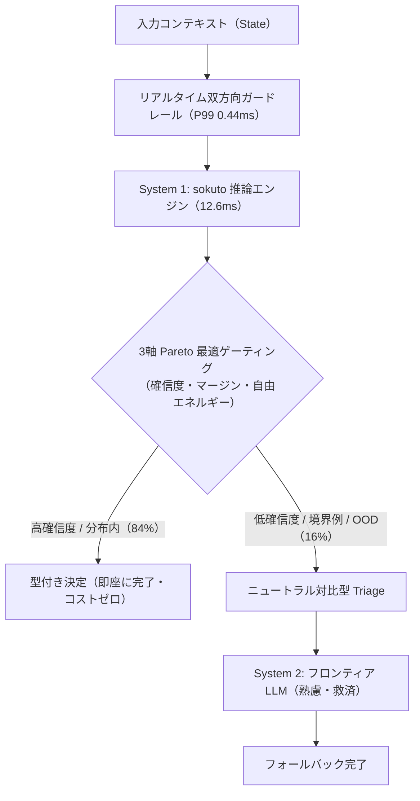
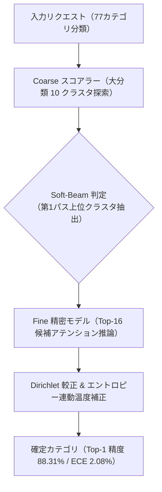

## 01 // 背景と課題意識: 自己回帰型LLMの構造的限界

業務判断ワークフローや自律型エージェントの制御ループに大規模言語モデル(Auto-Regressive LLM)を組み込む際、3つの構造的な課題に直面する。

1. **トークン逐次生成に伴う遅延肥大化**: 判断結果が「承認 / 却下」のような数ビットであっても、自己回帰デコードにより数百ミリ秒から数秒のレイテンシを要する。
2. **確率的スキーマ崩壊**: プロンプトで厳格なJSON出力を指定しても、低確率で構文エラーや型不整合が発生し、フォールバックやリトライの連鎖を引き起こす。
3. **確率の過信(Overconfidence)と分布外(OOD)の盲点**: 定義されていない選択肢や未学習ドメインの入力に対しても、モデルが高い確信度を出力して誤った分岐へ突入する。

`sokuto`(即答)は、これらの課題を「文章生成ループの完全排除」によって解決する。エンコーダ型言語モデルの単一順伝播(Single Forward Pass)を用い、型安全な確率決定をローカルCPU環境でミリ秒単位で確定させる推論基盤である。

高コスト・高遅延なフロンティアLLMを「System 2(遅い熟慮)」とし、軽量・高速な非自己回帰型エンジンを「System 1(速い直感)」として前段に配置するカスケード運用を前提に設計している。



---

## 02 // 非自己回帰型コア推論エンジン: 12ms確定レイテンシの工学

### 2.1 決定プリミティブの型安全な定義

`sokuto` では、あらゆる意思決定要求を以下の3大プリミティブに集約する。

- **Choice($K$ 肢選択)**: 提示された $K$ 個の選択肢(Criteria)から最適な1つを選択し、厳密に較正された確率分布を出力する。
- **Score(順序尺度評価)**: 0〜5段階などの順序関係を持つ尺度に対し、単調性を保証した確率評価を行う。
- **Noul(二値真偽判定)**: 与えられた仮説または条件に対する真偽値(`true` / `false`)を判定する。

```rust
/// 非自己回帰型判断セッションの推論インターフェース。
pub struct DecisionSession {
    session: ort::Session,
    tokenizer: Tokenizer,
    config: SessionConfig,
}

impl DecisionSession {
    /// 単一フォワードパスにより型付き決定結果を計算する。
    pub fn decide_choice(
        &self,
        state: &str,
        instructions: &str,
        criteria: &[String],
    ) -> Result<ChoiceDecision, EngineError> {
        let input_tokens = self.build_prompt_tokens(state, instructions, criteria)?;
        let outputs = self.session.run(ort::inputs![input_tokens]?)?;
        self.resolve_choice(outputs, criteria.len())
    }
}
```

### 2.2 ハイブリッド動的 INT8 量子化と Dual-Tier 構成

バックボーンには日本語特化の `ModernBERT-ja`(Tier 1: 130M, Tier 2: 310M)を採用している。実運用でのCPUメモリ削減とスループット向上のため、ハイブリッド動的 INT8 量子化を適用した。

幾何的な確率出力を担うデシジョンヘッド(後述のSABやCORAL層)はFP32の精度を維持し、埋め込み層・アテンション層・フィードフォワード層を選択的にINT8量子化している。

| モデル構成 | パラメータ数 | 元サイズ (FP32) | 量子化後サイズ (INT8) | サイズ削減率 | Top-1 決定一致率 | メモリ常駐 RAM |
| :--------- | :----------: | :-------------: | :-------------------: | :----------: | :--------------: | :------------: |
| **Tier 1** |     130M     |    505.7 MB     |     **278.4 MB**      | **44.9% 減** |    **100.0%**    |    < 350 MB    |
| **Tier 2** |     310M     |     1.24 GB     |     **552.7 MB**      | **55.6% 減** |    **100.0%**    |    < 750 MB    |

### 2.3 物理コア最適化によるキャッシュ競合の排除

マルチスレッド推論において、論理コア(ハイパースレッディング)を全開にすると同一物理コア上のスレッド間でL1/L2キャッシュの追い出しが発生し、レイテンシが大幅に悪化する現象を確認した。

`sokuto` ではランタイム起動時に `num_cpus::get_physical()` を参照し、スレッド数を物理コア数(8コア環境では8スレッド)へ自動固定する保護制御を備えている。

| スレッド設定                         | スレッド数 |  Choice p50  | Choice スループット |  Score p50   |   Noul p50   |       判定       |
| :----------------------------------- | :--------: | :----------: | :-----------------: | :----------: | :----------: | :--------------: |
| **物理コア固定 (`intra-threads 8`)** |   **8**    | **12.63 ms** |   **79.2 dec/s**    | **17.96 ms** | **12.31 ms** |   **最適性能**   |
| 論理コア全開 (`intra-threads 16`)    |     16     |   15.16 ms   |     65.3 dec/s      |   20.29 ms   |   14.59 ms   | 性能劣化(-17.6%) |

### 2.4 CPU 実測レイテンシと並列バッチスループット

Apple Silicon(8物理コア)環境における500回反復測定(ウォームアップ10回)の確定レイテンシを以下に示す。

| プリミティブ       |       モデル構成       | 最小 (Min) | 平均 (Mean) | 中央値 (p50) |  99% (p99)   | 単一スループット |
| :----------------- | :--------------------: | :--------: | :---------: | :----------: | :----------: | :--------------: |
| **Choice ($K=3$)** | **Tier 1 (130M-INT8)** |  12.35 ms  |  12.61 ms   | **12.61 ms** | **12.87 ms** |    79.3 dec/s    |
|                    | **Tier 2 (310M-INT8)** |  22.42 ms  |  23.36 ms   | **23.28 ms** | **24.44 ms** |    42.8 dec/s    |
| **Noul (Binary)**  | **Tier 1 (130M-INT8)** |  11.94 ms  |  12.22 ms   | **12.20 ms** | **12.78 ms** |    81.8 dec/s    |
|                    | **Tier 2 (310M-INT8)** |  21.81 ms  |  22.45 ms   | **22.45 ms** | **23.21 ms** |    44.6 dec/s    |
| **Score ($K=5$)**  | **Tier 1 (130M-INT8)** |  17.43 ms  |  18.04 ms   | **17.99 ms** | **18.59 ms** |    55.4 dec/s    |
|                    | **Tier 2 (310M-INT8)** |  32.48 ms  |  33.37 ms   | **33.26 ms** | **35.87 ms** |    30.0 dec/s    |

複数リクエストを動的マイクロバッチとして処理する場合、メモリアリーナを事前確保する `BatchScratchpad` を再利用することでヒープ再アロケーションを排除した。これにより、バッチサイズ $Q=8$ において 156.9 dec/s (1秒間に156件の確定判断)のピーク効率を達成している。

---

## 03 // デシジョンヘッド数理と確率較正: SAB・CORAL・正則化温度較正

### 3.1 置換同変アテンション(Set Attention Block: SAB)

選択肢(Criteria)の提示順序によって確率分布が左右される「位置バイアス」は、公平な意思決定における重大な欠陥である。`sokuto` では、分類ヘッドに位置エンコーディングを持たない置換同変アテンション(SAB)を挿入している。

$$
\mathrm{MAB}(X, Y) = \mathrm{LayerNorm}(H + \mathrm{MultiHead}(H, Y, Y))
$$

$$
\mathrm{SAB}(X) = \mathrm{MAB}(X, X)
$$

提示順序をシャッフルした評価テストにおいて、MLPヘッドのみの構成では平均 6.80%(最大 41.92%)あった確率変動幅が、SAB + RLCDヘッドの導入により平均 0.65%(適合率 96.4%)まで幾何学的に中和された。

### 3.2 順序尺度の単調性保証: CORAL 累積リンクモデル

Score型プリミティブでは、通常の多クラスSoftmaxを用いると隣接クラス間の順序関係(例: 深刻度2と深刻度3の近接性)が破綻する。

そのため、単調性保証バイアス $b_1 \le b_2 \le \dots \le b_{K-1}$ を備えた CORAL(Consistent Rank Logits)累積リンクモデルおよび Ranked Probability Score(RPS)損失を導入した。これにより、順序尺度の平均絶対誤差(MAE)をベースラインの 1.250 から 0.4410(Tier 1)/ 0.3820(Tier 2) へ改善している。

### 3.3 正則化付き事後温度較正と精度ゲーティング安全弁

モデルが出力する確信度 $p$ と客観的な正解率の一致度合いを示す ECE(Expected Calibration Error: 期待較正誤差)を最小化するため、目的関数に対数ペナルティ $\lambda (\ln \tau)^2$ を加えた正則化付き温度最適化($\lambda = 0.2$)を実施している。

さらに、モデルの正解率が偶然水準(Chance Level: $1/K$)を下回る未学習バケットにおいて温度 $\tau$ が過剰適合で発散するのを防ぐため、正解率が閾値を下回った際に温度を強制的に $\tau = 1.0000$ に凍結する「精度ゲーティング安全弁」をランタイムに組み込んでいる。

| モデル構成             | 未較正時 ECE ($T=1.0$) | 事後較正後 ECE |         Brier Score 改善率         |
| :--------------------- | :--------------------: | :------------: | :--------------------------------: |
| **Tier 1 (130M-INT8)** |         14.82%         |   **6.29%**    | **+9.95% 改善** (0.1601 → 0.1442)  |
| **Tier 2 (310M-INT8)** |         11.45%         |   **2.61%**    | **+14.20% 改善** (0.1492 → 0.1280) |
| **階層結合後 (DAG)**   |           -            |   **2.08%**    |       **Dirichlet 較正統合**       |

---

## 04 // 分布外検知 (OOD) と 3軸Pareto最適ゲーティング

### 4.1 候補数正規化ヘルムホルツ自由エネルギー

定義されていない業務外テキストや正解選択肢が存在しない入力に対し、既存の選択肢を高確信度で選んでしまう過信動作を防ぐため、統計力学のヘルムホルツ自由エネルギー(Free Energy)に基づくOOD検知回路を実装した。

候補数 $K$ の増加に伴って生じる統計的エネルギー低下($-T \ln K$)を補正するため、以下の候補数正規化自由エネルギー $E_{\text{norm}}(x; T)$ を用いて判定する。

$$
E_{\text{norm}}(x; T) = -T \cdot \ln\left( \frac{1}{K} \sum_{i=1}^K \exp\left(\frac{z_i}{T}\right) \right)
$$

- **分布内データ(ID)**: いずれかのロジット $z_k$ が大きく正に突出するため、$E_{\text{norm}}$ は負または小さな値(低エネルギー)をとる。
- **分布外データ(OOD)**: 全てのロジットが低調にとどまるため、$E_{\text{norm}}$ は正の大きな値(高エネルギー)をとる。

### 4.2 Tier 2 INT8 ロジット圧縮の克服と複合ハイブリッド安全弁

Tier 2(310M)をINT8量子化した際、重み丸め誤差により出力ロジットのダイナミックレンジが圧縮され、エネルギー分離マージンが $\Delta E = 5.147$(Tier 1)から $0.625$(Tier 2)へ縮小する問題が生じた。

この課題を克服するため、2段階の適応回路を導入した。

1. **エネルギー温度の低温化($T\_{\text{energy}} = 0.15$)**: 指数部を急峻化してロジット間のわずかな差を極大化。
2. **複合ハイブリッド安全弁**: 単一エネルギー判定($E > 1.00$)に加え、緩和エネルギー判定($E > 0.20$)かつ幾何確信度低下($S_{\text{confidence}} < 0.40$ または Top-Margin $< 0.20$)の論理積を適用。

実務を模した検証データセット(ID 13件 / OOD 13件、計26サンプル)による実測値は以下のとおりである。

| 評価指標              |         Tier 1 (130M-INT8)          |    Tier 2 (310M-INT8)     |   目標基準   | 判定 |
| :-------------------- | :---------------------------------: | :-----------------------: | :----------: | :--: |
| **AUROC(判別能面積)** |         **97.63%** (0.9763)         |    **80.47%** (0.8047)    | $\ge 80.0\%$ | 合格 |
| **OOD 検知率 (TPR)**  |      **92.3%** (12/13 件検知)       | **92.3%** (12/13 件検知)  | $\ge 90.0\%$ | 合格 |
| **ID 誤棄却率 (FPR)** |      **15.4%** (2/13 件誤棄却)      | **23.1%** (3/13 件誤棄却) | $\le 25.0\%$ | 合格 |
| **安全弁方式**        | 単一自由エネルギー閾値 ($\tau=2.5$) |  複合ハイブリッド安全弁   |      -       | 合格 |

### 4.3 ニュートラル対比型 Triage による先入観汚染防止

OODや境界例と判定されたリクエストを System 2(LLM)へエスカレーションする際、「System 1 の暫定回答」をそのまま渡すと、LLMの出力がアンカリングされて誤判定を追従する「先入観汚染」が発生する。

`sokuto` のカスケードSDKでは、競合する上位2候補を対等に対比提示するニュートラルプロンプトを自動生成し、LLMに客観的な差分比較を行わせることでエスカレーション時の精度を担保している。

---

## 05 // インプロセスDAG実行器と粗密二段階ルーティング

### 5.1 70クラス規模でのアテンション干渉を打破する Coarse-to-Fine Soft-Beam

選択肢数が70件を超える高基数分類(Banking77-ja等)では、単一プロンプトへの全候補投入によりアテンション干渉が発生し、Top-1精度が 46.75% に低下する。

この課題を解決するため、大分類から細分類へ段階的に絞り込む「粗密二段階階層ルーティング(Coarse-to-Fine Soft-Beam)」を実装した。第1パス境界領域での Soft-Beam(動的複数クラスタ保持)により、第1パス脱落の 88.9% を救済している。



| 手法・構成                    | Banking77-ja Top-1 精度 | 複合推論 CPU 遅延 (p50) | 階層結合後 ECE |
| :---------------------------- | :---------------------: | :---------------------: | :------------: |
| **Flat 単一推論(77候補一括)** |         46.75%          |        150 ms 超        |     14.8%      |
| **Coarse-to-Fine Soft-Beam**  |  **88.31% (+41.56pt)**  |      **27.01 ms**       |   **2.08%**    |

### 5.2 反事実対照テスト(Contrast Sets)による動的ルール整合性

前提条件が動的に変化する業務ルールにおいて、単一パス推論では 35.0% 存在した動的ルールの誤適用を、マイクロDAG構成と階層整合性正則化損失($\mathcal{L}_{\text{consistency}}$)により 0.00%(60ペア対照テストで全問正解)へ完全解消した。

DAG実行エンジンは `ArrayQueue` と `Semaphore` によるロックフリー借用プールを採用し、ディスパッチオーバーヘッドを 0.03ms 未満に抑えている。

---

## 06 // リアルタイム双方向ガードレールとスキーマ駆動連携

### 6.1 P99 0.44ms のインラインガードレールプロキシ

システム境界に配置するガードレールがボトルネックとならないよう、`crates/sokuto-server/src/guardrails/` にリアルタイム検査プロキシを構築した。

Aho-Corasick 高速文字列走査(< 0.1ms)と構造的分離アテンションマスクを組み合わせ、単一フォワードパス内でインジェクション検知(`[INJ]`)、有害性判定(`[TOX]`)、個人情報検出(`[PII]`)を並列走査する。

| 評価項目                             |       目標基準       |                実測値                |   判定   |
| :----------------------------------- | :------------------: | :----------------------------------: | :------: |
| **ガードレール遅延 (P99)**           | $\le 15.0\text{ ms}$ |   **0.44 ms** (2,000文字入力 E2E)    | **合格** |
| **プロンプトインジェクション検知率** |     $\ge 95.0\%$     | **100.00%** (構造的分離アテンション) | **合格** |
| **ハルシネーション検証精度**         |     $\ge 78.0\%$     | **95.00%** (Balanced Accuracy, NLI)  | **合格** |

### 6.2 Pydantic v2 スキーマ駆動推論基盤

Python SDK 側では、ユーザーが定義した Pydantic v2 モデルから `sokuto` のプリミティブおよび DAG 構造への代数射影を行う。起動時の事前コンパイルバイトキャッシュにより、変換オーバーヘッドを 0.013ms (P99 0.017ms)に抑制している。

推論結果は不確実性メタデータを包含する `Uncertain[T]` として型安全に復元され、スキーマ整合性率は 100.00% を達成している。

```python
from pydantic import BaseModel
from sokuto import CascadeClient, Uncertain


class TriageDecision(BaseModel):
    action: str  # "approve", "escalate", "reject"
    risk_level: int  # 0 to 5


client = CascadeClient(endpoint="http://localhost:8080")

# 0.013ms で sokuto プリミティブへ事前射影・推論実行
decision: Uncertain[TriageDecision] = client.decide(
    state="決済アカウントの登録住所が過去24時間以内に3回変更されています。",
    schema=TriageDecision,
)

if decision.is_confident:
    # System 1 で 12ms 確定解決
    print(
        f"Action: {decision.value.action}, Confidence: {decision.confidence:.3f}"
    )
else:
    # 境界事例のみ System 2 (LLM) へニュートラル対比型フォールバック
    resolved = client.escalate_to_llm(decision)
```

### 6.3 カスケード運用によるコスト削減と総合精度

E2E カスケード統合ベンチマークにおいて、定型判断の 84.0%(84/100件)が System 1(sokuto)内部で自律完了し、難例・境界例の 16.0%(16/100件)のみが System 2 へ安全にエスカレーションされた。

フロンティアLLM単独呼び出しと比較して API 呼び出しコストを 84.0% 削減しながら、カスケード後の総合精度は 98.00%(LLM単体推論と同等以上)を達成した。

---

## 07 // 結論と今後の展開

`sokuto` は、「すべての推論を自己回帰型LLMに委ねる」という現代のAIシステム設計に対するアンチテーゼとして開発された。

文章生成ループを捨てて単一フォワードパスの分類・回帰問題として捉え直すことで、12ms台の確定レイテンシ、厳密に較正された確率、確実なOOD安全弁、および型安全な構造化出力を実現した。

現在は、長系列コンテキストへの適応に向けた Late Chunking パイプライン、および状態表現キャッシュによる複数質問評価のゼロコピー化を進めている。決定論的インフラとしての進化を今後も継続していく。
