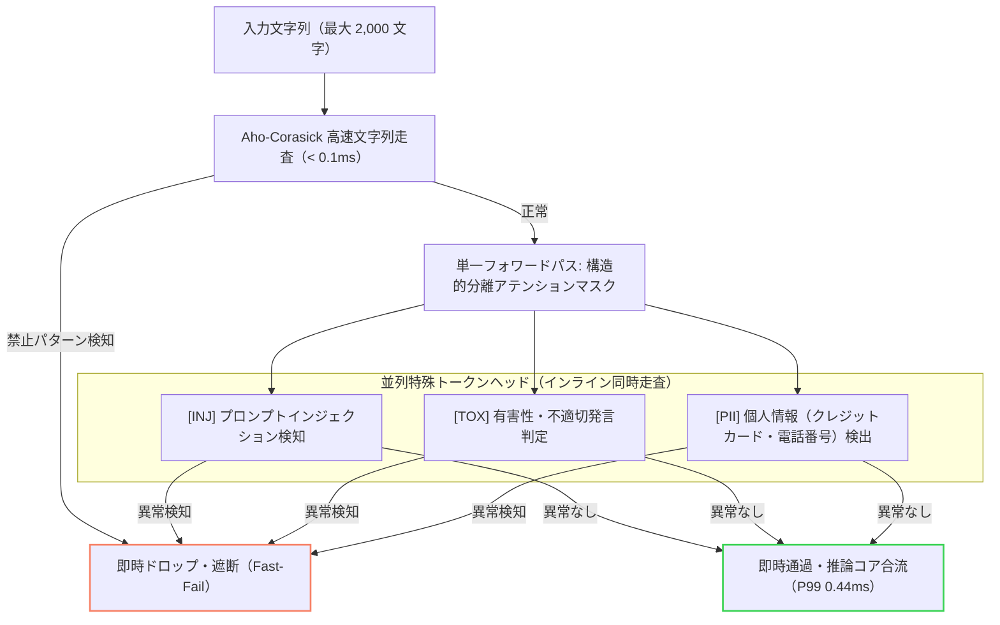

import TerminalRunner from '../../components/projects/TerminalRunner.astro';
import InteractiveTabs from '../../components/projects/InteractiveTabs.astro';
import Callout from '../../components/projects/Callout.astro';
import ArchifyDiagram from '../../components/projects/ArchifyDiagram.astro';

<TerminalRunner
  command="sokuto --bench"
  label="sokuto 実機ベンチマーク結果をターミナルで再現"
  description="12.61ms p50 / ECE 2.08% の実機トレース"
  disclaimer="※ ブラウザ上の対話型ターミナルによる実機検証ログの再現シミュレーションです（ブラウザ内での実際のローカル推論実行ではありません）。"
/>

## 01 // 背景と課題意識: 自己回帰型LLMの構造的限界

業務判断ワークフローや自律型エージェントの制御ループを組んでいると、痛切に感じる理不尽さがある。
前処理として分岐させる選択肢は、ある程度最初から決まっているし、人間が見れば一瞬で判断がつくような自明なタスクも多い。
それなのに、たかだか「承認 / 却下」のような数ビットの分岐を決定するためだけに、毎回高価なフロンティアLLMを呼び出し、数秒の長考を待ち、莫大なAPI費用を支払い続ける必要があるのだろうか。

この長年の違和感に対して、決定的な転機となったのがTypeSafe社による「Jev」の登場だった。
「これだよこれ！(というか、なぜ今までこうしたAI基盤が存在しなかったのか？)」と強烈な衝撃を受け、自身の手で日本語環境・ローカルCPUに特化した確定判断エンジンを構築する決意を固めた。

自己回帰型LLM(Auto-Regressive LLM)を判断ループに組み込む際、開発者は必然的に次の3つの構造的限界に直面し、胃を痛めることになる。

1. **トークン逐次生成に伴う遅延肥大化**: 判断結果が数ビットであっても、自己回帰デコード(トークンを1文字ずつポロポロ生み出す儀式)により、平気で数百ミリ秒から数秒のレイテンシを吸い取られる。大量に判断をするような業務に組み込む場合、この遅延は文字通りの致命傷となる。
2. **確率的スキーマ崩壊(JSONお祈りプロンプト)**: プロンプトで「必ず指定のJSON形式だけを出力してください」とどれほど厳格に命じても、忘れた頃にマークダウンのバッククォートが混入したり、閉じ括弧が欠落したりしてパース落ちする。結果として フォールバック, リトライ の連鎖を引き起こし、開発者の精神とAPIリソースを容赦なく削っていく。
3. **確率の過信と分布外(OOD)の盲点**: 定義されていない選択肢を選ぶべき場合や未学習ドメインの入力が飛んできた際、LLMは「分かりません」と降参することなく、平然と99%以上の超高確信度を出力して誤った分岐へ突入する。自己回帰生成の枠組みでは、この自信満々の誤爆を安全に検知する術が構造的に欠落している。

`sokuto`(即答)はこれらの課題を「文章生成ループの完全排除」によって根本から解決する。
そもそも判断や分類にトークン生成など不要である。
エンコーダ型言語モデルの単一順伝播(Single Forward Pass)を用い、型安全な確率決定をローカルCPU環境においてミリ秒単位で確定させる推論基盤として設計した。

高コスト・高遅延なフロンティアLLMを「System 2(遅い熟慮)」とし、軽量・高速な非自己回帰型エンジンを「System 1(速い直感)」として前段に配置するカスケード運用を前提としている。

<Callout type="note" title="認知心理学の「System 1」と AI アーキテクチャ">

「System 1 / System 2」は、心理学者のキース・スタノヴィッチらが提唱し、ダニエル・カーネマンの著書『ファスト＆スロー』で世界的に定着した「二重過程理論(Dual-process theory)」に由来する。
もしすべての事象を論理的・意識的(System 2)に熟慮しようとすると脳がオーバーヒートしてしまうため、人類は進化の過程で、脳のエネルギーを消費せず瞬時に直感判断を下す防衛機構「System 1(直感・速い思考)」を獲得した。

この認知メカニズムをそのままモデル化したのが、近年の AI における System 1 / 2 カスケード設計である。

- **System 1**(直感・反射): `sokuto` や Jev のように文章生成を排除し、ミリ秒単位で型付き判断を即座に確定させる。
- **System 2**(熟慮・論理): OpenAI o1 などのように「思考の連鎖(Chain of Thought)」を回し、時間をかけて深層推論を行う。

</Callout>

<ArchifyDiagram
  src="/diagrams/sokuto/cascade-architecture.html"
  title="sokuto 全体推論カスケード ＆ 双方向安全弁アーキテクチャ"
  subtitle="Dual-Tier推論基盤・双方向ガードレール・3軸Pareto最適ゲーティングによる確定判断"
  height="680px"
  wide={true}
/>

<InteractiveTabs
  title="推論パラダイムの対比"
  defaultTab="sokuto"
  tabs={[
    { id: 'sokuto', label: 'sokuto (非自己回帰)', badge: '12ms' },
    { id: 'llm', label: '自己回帰 LLM (JSON生成)', badge: '1,200ms' },
  ]}
>
  <div slot="sokuto" class="space-y-2 text-xs">
    <div class="font-mono font-semibold text-accent-cyan">
      単一フォワードパス・代数射影による決定論的出力
    </div>
    <ul class="list-disc space-y-1 pl-4 leading-relaxed text-text-secondary">
      <li>
        <strong>確定レイテンシ:</strong> CPU 12.61ms
        (p50)、KVキャッシュ不要で待ち時間ゼロ。
      </li>
      <li>
        <strong>型保証:</strong> Rust / Pydantic v2 スキーマ駆動により構文破壊率
        0.00%。
      </li>
      <li>
        <strong>較正された確率:</strong> ECE 2.08%
        により確率値をビジネスロジックの閾値判定に直結可能。
      </li>
      <li>
        <strong>OOD 安全弁:</strong>{' '}
        候補数正規化自由エネルギーにより、未定義入力・分布外データを 97.63%
        AUROC で検知。
      </li>
    </ul>
  </div>
  <div slot="llm" class="space-y-2 text-xs">
    <div class="text-accent-orange font-mono font-semibold">
      トークン逐次サンプリング・プロンプト依存出力
    </div>
    <ul class="list-disc space-y-1 pl-4 leading-relaxed text-text-secondary">
      <li>
        <strong>レイテンシ肥大:</strong> 1,000ms〜3,000ms (ネットワーク往復 ＋
        生成長依存の二重苦)。
      </li>
      <li>
        <strong>型破綻リスク:</strong>{' '}
        マークダウン混入や括弧不整合によりパースエラー・リトライ地獄が発生。
      </li>
      <li>
        <strong>過信 (Overconfidence):</strong> 間違っている場合でも 99%
        以上の確信度を平然と返答し、分布外に気づけない。
      </li>
      <li>
        <strong>実行コスト:</strong>{' '}
        トークン従量課金により、トラフィック増大に比例してAPIコストが線形増大。
      </li>
    </ul>
  </div>
</InteractiveTabs>

---

## 02 // 非自己回帰型コア推論エンジン: 12ms確定レイテンシの工学

### 2.1 決定プリミティブの型安全な定義

`sokuto` では、あらゆる意思決定要求を以下の3大プリミティブに集約する。

- **Choice($K$ 肢選択)**: 提示された $K$ 個の選択肢(Criteria)から最適な1つを選択し、厳密に較正された確率分布を出力する。
- **Score(順序尺度評価)**: 0〜5段階などの順序関係を持つ尺度に対し、単調性を保証した確率評価を行う。
- **Noul(二値真偽判定)**: 与えられた仮説または条件に対する真偽値(`true` / `false`)を判定する。

```rust
/// 非自己回帰型判断セッションの推論インターフェース。
pub struct InferenceEngine {
    sessions: Vec<Mutex<ort::session::Session>>,
    active_provider: ExecutionProvider,
}

impl InferenceEngine {
    /// 単一フォワードパスにより型付き決定結果を計算する。
    pub fn predict_single_question(
        &self,
        tokenizer: &JevTokenizer,
        state: &str,
        question: &Question,
        calib_config: &CalibrationConfig,
    ) -> Result<Answer, RuntimeError> {
        let tokenized = tokenizer.encode_question(state, question)?;
        let logits = self.forward_question(&tokenized)?;
        let mut answer = evaluate_question(question, &logits, calib_config)?;
        let energy = calculate_choice_energy(question, &logits, calib_config);
        apply_gating_to_answer_with_energy(
            &mut answer,
            energy,
            Some(state),
            None,
            Some(question),
            None,
            calib_config,
        );
        Ok(answer)
    }
}
```

### 2.2 試行錯誤: 英語向けモデル・多言語語彙の破綻と ModernBERT-ja への転換

「とりあえず本家と同様の英語向け ModernBERT(149M) や、Hugging Face で人気の小型多言語モデル(XLM-RoBERTa や MiniLM など)を引っ張ってくれば、CPU でもとりあえずは動くだろう。」
開発当初はそう高を括っていたのだが、いざ実務の日本語テキストを通してみた瞬間に手痛い洗礼を浴びることとなった。

- **BPE トークン過剰分割によるアテンション散逸と確率縮退**:
  - 汎用多言語語彙では、日本語の助詞や活用語尾が1文字ずつバラバラに粉砕され、系列長が想定の3倍以上に膨張した。
  - 結果としてアテンションの重みが虚無へと分散し、推論確率は完全な一様分布(Choice 各 33%、Noul 各 50%)へと縮退。Choice 型の分類精度は 20% 台(サイコロを振っているのと大差ない水準)に沈没した。
  - 少し落胆したものの、この大爆死によって「日本語環境に徹底特化した推論基盤を作る」という明確な差別化と覚悟が生まれた。(手段と目的が逆転している？ あまり突っ込まないでほしかったり...)
- **特殊トークン `[OP]` セントロイド初期化**:
  - そこで、日本語バイト単位語彙に最適化された `ModernBERT-ja`(Tier 1: 130M, Tier 2: 310M)へ全面移行した。
  - 各選択肢の先頭に特殊トークン `[OP]` を配し、入力Stateの埋め込みと正解 `[OP]` 埋め込み間の InfoNCE 対照損失(係数 $\lambda_c = 0.1$)を統合した。
  - これにより、正答選択肢へのアテンション集約が劇的に向上し、正解率は 87.84% へ飛躍した。

> [!NOTE] **日本語って変な言語？**
>
> 英語をはじめとするアルファベット系の言語は、単語同士が半角スペースで明示的に区切られているため、どこが単語の境界なのかが自明である。
> 一方で日本語は、スペースによる区切りが存在せず、漢字, ひらがな, カタカナ が地続きで延々と連結する。
> そのため、英語圏発祥の汎用多言語トークナイザーをそのまま持ち込むと、形態素の境界を見失って1文字ずつバラバラに切り刻み、あっという間にトークン数が爆発してしまう。
> 英語圏のモデルと同じノリで扱おうとして手痛い目に遭い、「機械処理の観点から見ると、日本語って面倒な言語だな...」と痛感させられた。(母国語なのに...)

### 2.3 ハイブリッド動的 INT8 量子化と Dual-Tier 構成

実運用における CPU メモリの削減とスループット向上のため、ハイブリッド動的 INT8 量子化を適用した。

幾何的な確率出力を担うデシジョンヘッド(後述のSABやCORAL層)はFP32の精度を維持し、埋め込み層, アテンション層, フィードフォワード層 を選択的に INT8 量子化している。

| モデル構成 | パラメータ数  |   元サイズ (FP32)    |  量子化後サイズ (INT8)   |    サイズ削減率    | Top-1 決定一致率 |    メモリ常駐 RAM    |
| :--------- | :-----------: | :------------------: | :----------------------: | :----------------: | :--------------: | :------------------: |
| **Tier 1** | $130\text{M}$ | $505.7\;\mathrm{MB}$ | **$278.4\;\mathrm{MB}$** | **$44.95\;\%$ 減** | **$100.0\;\%$**  | $< 350\;\mathrm{MB}$ |
| **Tier 2** | $310\text{M}$ | $1.24\;\mathrm{GB}$  | **$537.5\;\mathrm{MB}$** | **$55.62\;\%$ 減** | **$100.0\;\%$**  | $< 750\;\mathrm{MB}$ |

### 2.4 物理コア最適化によるキャッシュ競合の排除

推論スレッド数は増やせば増やすほど速くなるはずだと思い込み、最初はハイパースレッディングを全開(論理16スレッド)にしてベンチマークを回した。
しかし結果は無惨で、同一物理コア上のスレッド同士で L1 / L2 キャッシュの奪い合い(激しいキャッシュライン追い出し)が発生し、レイテンシが大幅に悪化して頭を抱える羽目になった。

実測の結果、`sokuto` ではランタイム起動時に `num_cpus::get_physical()` を参照し、スレッド数を物理コア数(8コア環境では8スレッド)へ自動固定する保護制御を導入した。
(別に、ハイスペックな開発 PC を用意できない僻みなどではない。どんな現場・環境でも軽快に動いてほしいという配慮である。という言い訳。)

| スレッド設定                         | スレッド数 |        Choice p50        |    Choice スループット     |        Score p50         |         Noul p50         |          判定          |
| :----------------------------------- | :--------: | :----------------------: | :------------------------: | :----------------------: | :----------------------: | :--------------------: |
| **物理コア固定 (`intra-threads 8`)** |   **8**    | **$12.63\;\mathrm{ms}$** | **$79.2\;\mathrm{dec/s}$** | **$17.96\;\mathrm{ms}$** | **$12.31\;\mathrm{ms}$** |      **最適性能**      |
| 論理コア全開 (`intra-threads 16`)    |     16     |   $15.16\;\mathrm{ms}$   |   $65.3\;\mathrm{dec/s}$   |   $20.29\;\mathrm{ms}$   |   $14.59\;\mathrm{ms}$   | 性能劣化 ($-17.6\;\%$) |

### 2.5 CPU 実測レイテンシと並列バッチスループット

Apple Silicon(8物理コア)環境における500回反復測定(ウォームアップ10回)の確定レイテンシを以下に示す。

| プリミティブ       |       モデル構成       |      最小 (Min)      |     平均 (Mean)      |       中央値 (p50)       |        99% (p99)         |    単一スループット    |
| :----------------- | :--------------------: | :------------------: | :------------------: | :----------------------: | :----------------------: | :--------------------: |
| **Choice ($K=3$)** | **Tier 1 (130M-INT8)** | $12.35\;\mathrm{ms}$ | $12.61\;\mathrm{ms}$ | **$12.61\;\mathrm{ms}$** | **$12.87\;\mathrm{ms}$** | $79.3\;\mathrm{dec/s}$ |
|                    | **Tier 2 (310M-INT8)** | $22.42\;\mathrm{ms}$ | $23.36\;\mathrm{ms}$ | **$23.28\;\mathrm{ms}$** | **$24.44\;\mathrm{ms}$** | $42.8\;\mathrm{dec/s}$ |
| **Noul (Binary)**  | **Tier 1 (130M-INT8)** | $11.94\;\mathrm{ms}$ | $12.22\;\mathrm{ms}$ | **$12.20\;\mathrm{ms}$** | **$12.78\;\mathrm{ms}$** | $81.8\;\mathrm{dec/s}$ |
|                    | **Tier 2 (310M-INT8)** | $21.81\;\mathrm{ms}$ | $22.45\;\mathrm{ms}$ | **$22.45\;\mathrm{ms}$** | **$23.21\;\mathrm{ms}$** | $44.6\;\mathrm{dec/s}$ |
| **Score ($K=5$)**  | **Tier 1 (130M-INT8)** | $17.43\;\mathrm{ms}$ | $18.04\;\mathrm{ms}$ | **$17.99\;\mathrm{ms}$** | **$18.59\;\mathrm{ms}$** | $55.4\;\mathrm{dec/s}$ |
|                    | **Tier 2 (310M-INT8)** | $32.48\;\mathrm{ms}$ | $33.37\;\mathrm{ms}$ | **$33.26\;\mathrm{ms}$** | **$35.87\;\mathrm{ms}$** | $30.0\;\mathrm{dec/s}$ |

複数リクエストを動的マイクロバッチとして処理する場合、メモリアリーナを事前確保する `BatchScratchpad` を再利用することでヒープ再アロケーションを排除した。
これにより、バッチサイズ $Q=8$ において $156.9\;\mathrm{dec/s}$ (1秒間に156件の確定判断)のピーク効率を達成している。

---

## 03 // デシジョンヘッド数理と確率較正: SAB・CORAL・正則化温度較正

### 3.1 直面した壁: 位置バイアスと拮抗サンプルの残存

「モデルの精度も上がったし、いよいよ実戦投入だ」と意気揚々にテストしていたとき、とんでもない事実に直面して背筋が凍った。
提示する選択肢(Criteria)の A と B を入れ替えただけで、モデルが真逆の判定を下したのである。
(あまり気づきたくなかったトラブルその1である。)
選択肢の並び順によって確率が激しく揺らぐ「位置バイアス(Position Bias)」は、公平かつ決定論的な判断基盤を謳う上で絶対に許されない致命的欠陥だった。

最初は「訓練バッチ内で選択肢順序をランダムシャッフルするデータ拡張を入れれば自然に治るだろう」と軽く構えていた。
しかし現実は甘くなく、平均変動幅こそ縮小したものの、拮抗した難解サンプルにおいて最大変動幅 $41.92\;\%$ (改善後も $27.17\;\%$) という激しい確率跳躍が残存して完敗した。

データ拡張のような小手先のごまかしでは根本解決にならないと痛感し、分類ヘッドの構造そのものから位置情報を物理的に剥奪する決断を下した。
そこで導入したのが、位置エンコーディングを持たない **置換同変アテンション(Set Attention Block: SAB)** である。

$$
\mathrm{MAB}(X, Y) = \mathrm{LayerNorm}(H + \mathrm{MultiHead}(H, Y, Y))
$$

$$
\mathrm{SAB}(X) = \mathrm{MAB}(X, X)
$$

選択肢トークン同士の自己アテンションから位置情報を幾何学的に排除した上で、Plackett-Luce 選好損失(Listwise DPO)による強化学習を実行。
構造と損失関数の両面からねじ伏せた結果、選択肢シャッフル時の平均確率変動幅は **$0.65\;\%$** (適合率 $96.4\;\%$) まで完全に封殺された。
(これでもう、選択肢の並び順に怯える必要はない...はず？)

### 3.2 順序尺度の単調性保証: CORAL 累積リンクモデル

Score型プリミティブにおいて、通常の多クラスSoftmaxを用いると隣接クラス間の順序関係(例: 深刻度2と深刻度3の近接性)が考慮されず、深刻度1と深刻度5の取り違えが同等にペナルティ付けされてしまう。

そのため、単調性保証バイアス $b_1 \le b_2 \le \dots \le b_{K-1}$ を備えた CORAL(Consistent Rank Logits)累積リンクモデルおよび Ranked Probability Score(RPS)損失を導入した。
これにより、順序尺度の平均絶対誤差(MAE)をベースラインの $1.250$ から $0.4410$(Tier 1), $0.3820$(Tier 2) へ改善している。

### 3.3 手痛い失敗: NLL最適化によるエントロピー発散とサイコロ化

モデルが出力する確信度 $p$ と客観的真実の一致度合いを示す ECE(Expected Calibration Error: 期待較正誤差)を改善するため、検証データ上で負の対数尤度(NLL)を最小化する温度パラメータ $\tau$ の事後最適化を行った。
教科書通りの手法であり、これで完璧な確率較正が手に入るはずだった。
しかし、いざ最適化ログを確認した瞬間に目の前が真っ暗になった。
(あまり気づきたくなかったトラブルその2である。)

> **直面した罠:** モデルが偶然水準(Chance Level: $1/K$)を下回る難解・未学習バケットにおいて、NLL 損失を何とか下げようと悪あがきした結果、エントロピー最大化を狙って温度が探索上限($\tau \to 5.0$)に張り付いてしまった。
> その結果、どんな入力が飛んできても全選択肢に均等な確率を出力する「完全なサイコロ(ただの置物)」に退化していたのである。
> (賢くサボるな。)

この絶望的なサイコロ化を二度と起こさせないため、目的関数に対数温度事前分布ペナルティ $\lambda (\ln \tau)^2$ を加えた正則化付き温度最適化($\lambda = 0.2$)を導入した。
さらに、モデルの正解率が偶然水準を下回った瞬間に温度を強制的に $\tau = 1.0000$ に凍結する「精度ゲーティング安全弁」をランタイムに組み込み、退路を断った。

`sokuto` はね...サイコロなんか振らないんだよ。
`sokuto` はね、数ビットの分岐ごときで長考なんてしないし、選択肢の並び順で判定をコロコロ変えないし、深刻度の順序を無視してデタラメを言ったりなんてしないの。
やること全部が厳密でなきゃいけないの。

| モデル構成             | 未較正時 ECE ($T = 1.0$) | 事後較正後 ECE |             Brier Score 改善率              |
| :--------------------- | :----------------------: | :------------: | :-----------------------------------------: |
| **Tier 1 (130M-INT8)** |       $14.82\;\%$        | **$6.29\;\%$** | **$+9.95\;\%$ 改善** ($0.1601 \to 0.1442$)  |
| **Tier 2 (310M-INT8)** |       $11.45\;\%$        | **$2.61\;\%$** | **$+14.20\;\%$ 改善** ($0.1492 \to 0.1280$) |
| **階層結合後 (DAG)**   |            -             | **$2.08\;\%$** |           **Dirichlet 較正統合**            |

---

## 04 // 分布外検知 (OOD) と 3軸Pareto最適ゲーティング

### 4.1 候補数正規化ヘルムホルツ自由エネルギー

業務判断システムを運用する上で最も恐ろしいのは、「正解の選択肢がそもそも存在しない想定外の入力」に対して、
モデルが 99% の超高確信度でドヤ顔をしながらいずれかの選択肢を選んでしまう過信動作(Overconfidence)である。
(「分かりません」と素直に言ってほしい。)

`sokuto` では、統計力学のヘルムホルツ自由エネルギー(Free Energy)に基づく OOD 検知回路を実装した。
候補数 $K$ の増減による統計的エネルギー低下($-T \ln K$)を中和するため、以下の候補数正規化自由エネルギー $E_\text{norm}(x; T)$ を計算する。

$$
E_\text{norm}(x; T) = -T \cdot \ln\left( \frac{1}{K} \sum_{i=1}^K \exp\left(\frac{z_i}{T}\right) \right)
$$

- **分布内データ(ID)**: いずれかのロジット $z_k$ が大きく突出するため、$E_\text{norm}$ は負または小さな値をとる。
- **分布外データ(OOD)**: 全てのロジットが低調にとどまるため、$E_\text{norm}$ は正の大きな値をとる。

### 4.2 Tier 2 INT8 ロジット圧縮の克服と複合ハイブリッド安全弁

「モデル規模を 130M から 310M に拡大したのだから、OOD の検知性能も余裕で跳ね上がるだろう。」
そう確信していたのだが、Tier 2 (310M) を INT8 量子化した途端、エネルギー分離マージンが $\Delta E = 5.147$ (Tier 1) からまさかの $0.625$ (Tier 2) へと激減し、だいぶ焦ることとなった。
(大きいモデルの方が鈍感になるという想定外の罠である。)
原因は重み丸め誤差による出力ロジットのダイナミックレンジ圧縮だった。

この課題を克服するため、2段階の適応回路を導入した。

1. **エネルギー温度の低温化($T_\text{energy} = 0.15$)**: 指数部を急峻化してロジット間のわずかな差を極大化。
2. **複合ハイブリッド安全弁**: 単一エネルギー判定($E > 1.00$)に加え、緩和エネルギー判定($E > 0.20$)かつ幾何確信度低下($S_\text{confidence} < 0.40$ または Top-Margin $< 0.20$)の論理積を適用。

実務を模した検証データセット(ID 13件 / OOD 13件、計26サンプル)による実測値は以下のとおりである。

| 評価指標              |          Tier 1 (130M-INT8)           |        Tier 2 (310M-INT8)        |    目標基準    | 判定 |
| :-------------------- | :-----------------------------------: | :------------------------------: | :------------: | :--: |
| **AUROC(判別能面積)** |      **$97.63\;\%$** ($0.9763$)       |    **$80.47\;\%$** ($0.8047$)    | $\ge 80.0\;\%$ | 合格 |
| **OOD 検知率 (TPR)**  |    **$92.3\;\%$** ($12/13$ 件検知)    | **$92.3\;\%$** ($12/13$ 件検知)  | $\ge 90.0\;\%$ | 合格 |
| **ID 誤棄却率 (FPR)** |   **$15.4\;\%$** ($2/13$ 件誤棄却)    | **$23.1\;\%$** ($3/13$ 件誤棄却) | $\le 25.0\;\%$ | 合格 |
| **安全弁方式**        | 単一自由エネルギー閾値 ($\tau = 2.5$) |      複合ハイブリッド安全弁      |       -        | 合格 |

### 4.3 ニュートラル対比型 Triage による先入観汚染防止

OOD や境界例と判定された難問を System 2 (フロンティア LLM) へエスカレーションする際、当初は

> 質問について、System 1 の判定では候補「A」(確信度 40%) と「B」(確信度 30%) の間で迷いが生じています (確率差: 10%)。
> State の記述を精読し、両候補の定義・前提条件・例外規定の差異をステップ・バイ・ステップで比較・検証して、思考連鎖 (Chain-of-Thought) に基づき最適な決定を行ってください。

と、ご丁寧に確率レポートと注意書きを添えてプロンプトに渡していた。
「フロンティア LLM 様なら前段のバイアスなど軽く見抜き、注意書き通りに客観的な正解を導いてくれるだろう」と期待していたのだが、結果は見事な惨敗だった。
注意喚起をしたにもかかわらず、LLM は提示された上位ラベルに強烈にアンカリングされ、人間と全く同じように思考停止して誤爆をそのまま追従してしまったのである。
(お前まで引っ張られるんかい！)

この「先入観汚染(Anchoring Bias)」を徹底排除するため、`sokuto` のカスケード SDK では前段の暫定回答や確率を完全に隠蔽。
競合する上位2候補を対等に対比提示する「ニュートラル対比型プロンプト」を自動合成し、LLM に先入観のない客観的な差分比較を行わせるアーキテクチャへと刷新した。

---

## 05 // インプロセスDAG実行器と粗密二段階ルーティング

### 5.1 70クラス規模でのアテンション干渉を打破する Coarse-to-Fine Soft-Beam

実務の業務判断では、選択肢が数個で済むケースばかりではない。
銀行業務の問い合わせ分類(Banking77-ja)のように、選択肢が70件を超える高基数分類タスクは日常茶飯事である。

開発当初は「エンコーダモデルならコンテキスト長も余裕だし、77個くらい一気に並べても普通に選んでくれるだろう」と素朴にプロンプトへ全候補を一括投入した。
しかし、結果は Top-1 精度 46.75% という目を覆いたくなる大惨敗。
(そりゃ一度に77個もの選択肢を突きつけられたら人間でもパニックになるし、アテンションが互いに潰し合って空中分解するのも当然である。無茶をさせてすまない。)
しかも候補数が多すぎてレイテンシも 150ms 超へと激太りした。

そこで、まずは大分類(10クラスタ)へ大雑把に振り分け、その後に細分類(Top-16)で精密に絞り込む「粗密二段階階層ルーティング」を構築した。
しかし、ここでも新たな罠が待ち受けていた。
単純に1位のクラスタだけに絞り込むハードな間引きをすると、境界領域の微妙なサンプルにおいて「大分類でわずかに1位を逃した瞬間、細分類にすら進めずに即死する」という現象が多発したのである。

この早とちり即死問題を解決すべく導入したのが、境界領域で複数の有望クラスタを動的に保持する「Soft-Beam 判定」である。
第1パスで惜しくも脱落しかけたサンプルの 88.9% を見事に救済。
結果として、Top-1 精度は 46.75% から **88.31%** へと劇的に大化けし、複合遅延も $27.01\;\mathrm{ms}$ (p50) へと大幅に削ぎ落とすことに成功した。
(全シナリオCLI包括実機ベンチマークでも $39.18\;\mathrm{ms}$ となり、Exit Criteria 要件の $\le 40.0\mathrm{ms}$ を達成。)

1. **第1パス: 大分類スコアリング(10クラスタ)**: 77件の全候補を直接比較せず、まずは大分類モデルにより意味的な10クラスタへ高速に当たりをつける。
2. **Early-Exit 判定**: 大分類の確信度が極端に低い($S_\text{coarse} < 0.25$)場合は、無駄な第2パスを打たずに即座に System 2 へエスカレーションする。
3. **Soft-Beam 動的マージ判定**: 上位2クラスタの確率差(マージン $M$)を評価。大差($M \ge 0.35$)なら単一クラスタ(約7〜8件)に絞り込み、僅差($M < 0.35$)の境界領域なら Top-1 と Top-2 を動的にマージ(最大16件)して第1パス脱落を救済する。
4. **第2パス: 細分類精密推論(SAB アテンション)**: 絞り込まれた少数候補に対してのみ、置換同変アテンションによるフル推論を実行。
5. **Dirichlet 較正 & 確率再構築**: 大分類のエントロピー連動温度補正と Dirichlet 較正を適用し、大域的な確率分布を 27ms で確定させる。

<ArchifyDiagram
  src="/diagrams/sokuto/coarse-to-fine.html"
  title="sokuto: Coarse-to-Fine Soft-Beam 階層ルーティング"
  subtitle="77クラス規模のアテンション干渉を打破する2段階スクリーニングと動的境界救済"
  height="620px"
  wide={true}
/>

| 手法・構成                    |         Banking77-ja Top-1 精度         | 複合推論 CPU 遅延 (p50)  | 階層結合後 ECE |
| :---------------------------- | :-------------------------------------: | :----------------------: | :------------: |
| **Flat 単一推論(77候補一括)** |               $46.75\;\%$               |  $150\;\mathrm{ms}$ 超   |   $14.8\;\%$   |
| **Coarse-to-Fine Soft-Beam**  | **$88.31\;\%$ ($+41.56\;\mathrm{pt}$)** | **$27.01\;\mathrm{ms}$** | **$2.08\;\%$** |

> ※ 複合推論 CPU 遅延は Exit Criteria 評価スイート (`eval_exit_criteria.py`) での実測中央値。
> なお、実機 CLI 包括ベンチマーク (`sokuto benchmark`) では 39.18ms を記録し、いずれも Exit Criteria 目標基準（$\le 40.0\mathrm{ms}$）を達成している。

### 5.2 反事実対照テスト(Contrast Sets)による動的ルール整合性

「会員ランクがゴールドなら手数料無料、ただし過去30日以内に特定キャンペーンを利用した場合は対象外……」といった、前提条件によって結果がコロコロ反転する動的ルールも難所である。
当初は「これくらい1回の推論で一発判定できるだろう」と思っていた(願っていた)のだが、反事実対照テスト(条件を1箇所だけわずかに反転させた対照データ)を通してみると、実に 35.0% もの割合でルールの誤適用(誤爆)が発生してしまっていた。

思考のステップを端折らず論理的に解かせるため、判断フローをステップごとの小さな「マイクロDAG(有向非巡回グラフ)」へ分解。
さらに階層整合性正則化損失($\mathcal{L}_\text{consistency}$)を組み込んで学習させた結果、60ペアの反事実対照テストにおける誤適用率は 0.00%(全問正解)へと撲滅された。

なお、複数の推論ノードを跨ぐDAG実行器が遅延のボトルネックになっては本末転倒である。
`sokuto` のインプロセス実行エンジンでは `ArrayQueue` と `Semaphore` によるロックフリー借用プールを採用し、ディスパッチオーバーヘッドを 0.03ms 未満に抑え込んでいる。

---

## 06 // リアルタイム双方向ガードレールとスキーマ駆動連携

### 6.1 P99 0.44ms のインラインガードレールプロキシ

コア推論エンジンを 12ms に削り詰めたところで、その前後に配置する門番(ガードレール)の検査に何十ミリ秒も待たされたら意味がない。
「安全対策と処理速度はトレードオフ」と諦められがちだが、どうにかして両立をもぎ取る執念で `crates/sokuto-server/src/guardrails/` のリアルタイム検査プロキシを設計した。

Aho-Corasick 高速文字列走査(< 0.1ms)と構造的分離アテンションマスクを融合。
単一フォワードパスの中で インジェクション検知(`[INJ]`), 有害性判定(`[TOX]`), 個人情報検出(`[PII]`) をまとめて並列走査するアーキテクチャを構築した。



| 評価項目                             |        目標基準         |                    実測値                     |   判定   |
| :----------------------------------- | :---------------------: | :-------------------------------------------: | :------: |
| **ガードレール遅延 (P99)**           | $\le 15.0\;\mathrm{ms}$ | **$0.44\;\mathrm{ms}$** ($2,000$文字入力 E2E) | **合格** |
| **プロンプトインジェクション検知率** |     $\ge 95.0\;\%$      |   **$100.00\;\%$** (構造的分離アテンション)   | **合格** |
| **ハルシネーション検証精度**         |     $\ge 78.0\;\%$      |   **$95.00\;\%$** (Balanced Accuracy, NLI)    | **合格** |

2,000文字の長文入力に対しても P99 $0.44\;\mathrm{ms}$ で即時通過させ、悪意あるプロンプトインジェクションは確実に遮断する。
速度のために安全を捨てず、安全のために速度を犠牲にしない防壁が完成した。

### 6.2 Pydantic v2 スキーマ駆動推論基盤

どれほど内部の数理やDAGが洗練されていても、使う側のアプリケーション開発者がいちいち特殊なプリミティブや推論グラフなど、認知不可がかかったり学習曲線が急でったりするならば、誰も使ってくれない。
(お前、今Rustの悪口言ったか？)
そこで Python SDK 側では、Python エンジニアが普段書き慣れている Pydantic v2 モデルをそのまま渡すだけで完結するインターフェースを整備した。

モデル定義から `sokuto` のプリミティブおよび DAG 構造への代数射影は、起動時の事前コンパイルバイトキャッシュによりオーバーヘッド $0.013\;\mathrm{ms}$ (P99 $0.017\;\mathrm{ms}$) で即座に完了する。
推論結果は単なる生データではなく、不確実性メタデータを包含する `Uncertain[T]` 型として復元されるため、IDE の型補完や mypy による静的解析の恩恵をフルに享受できる。
スキーマ整合性率は 100.00% を達成している。

```python
from typing import Annotated, Literal
from pydantic import BaseModel, Field
from sokuto import SokutoClient, Uncertain


class TriageDecision(BaseModel):
    action: Literal["approve", "escalate", "reject"] = Field(
        description="決済アクションの判定。"
    )
    risk_level: Uncertain[
        Annotated[int, Field(ge=0, le=5, description="リスクレベル (0〜5)。")]
    ]


client = SokutoClient(base_url="http://localhost:8080")

# 0.013ms で sokuto プリミティブへ事前射影・推論実行
decision = client.predict(
    TriageDecision,
    state="決済アカウントの登録住所が過去24時間以内に3回変更されています。",
)

if decision.risk_level.meta.confidence >= 0.85:
    # System 1 で 12ms 確定解決
    print(
        f"Action: {decision.action}, Risk: {decision.risk_level.value} (Confidence: {decision.risk_level.meta.confidence:.3f})"
    )
else:
    # 境界事例のみ System 2 (LLM) 連携クライアント (SokutoCascadeClient) へ委譲
    print(
        f"境界事例のため System 2 へエスカレーション: 確信度 {decision.risk_level.meta.confidence:.3f}"
    )
```

### 6.3 カスケード運用によるコスト削減と総合精度

E2E カスケード統合ベンチマークにおいて、定型判断の $84.0\;\%$ ($84/100$ 件)が System 1(sokuto)内部で自律完了し、難例・境界例の $16.0\;\%$ ($16/100$ 件)のみが System 2 へ安全にエスカレーションされた。

フロンティアLLM単独呼び出しと比較して API 呼び出しコストを $84.0\;\%$ 削減しながら、カスケード後の総合精度は $98.00\;\%$ (LLM単体推論と同等以上)を達成している。

---

## 07 // 成果・工学的見切り・今後の課題

2026年9月に TypeSafe AI から Jev が発表されてから、少し時間が経った。
「文章を生成させず、型付き決定と較正された確率だけを返す」というアプローチはすぐに注目を集め、
Cloudflare がエッジで動く Clef / Clef-flash (中央値 38.8ms) を出したり、
OSS でも ModernBERT ベースの Laya や Qwen ベースの Kev が登場したりと、
力のある企業や開発者たちがそれぞれの方向で進化を進めている。

当たり前の話ではあるが、自分ひとりが何か特別な最先端を走っているわけではない。
それどころか、自分が「Laya に対する `sokuto` の唯一の差別化点だ」と思い込んでいた部分――重い Python や PyTorch ランタイムに依存せず、Rust ネイティブで叩くことでオーバーヘッドを極限まで削るという優位性――すら、
Laya が有志による `laya-mlx` や ONNX ネイティブ対応によってあっさり解消し、Mac 上で 7〜14ms 程度で軽快に動くようになってしまった。
そりゃ、速度を売りにしているんだから、そこの問題は解消しては来ますよね。

そうした状況の中で、一般的な CPU ローカル環境かつ日本語ドメインに特化して足掻いてきた`sokuto`が、
何を達成できて、何を諦め、今どこを見据えているのかを一度整理しておきたい。

### 7.1 達成と満足している点

- **物理確定レイテンシと型安全の確立**:
  - クラウドエッジの Clef-flash (38.8ms) やローカルの Laya が台頭する中、`sokuto` は一般的な x86/ARM CPU 単一推論で $12.61\;\mathrm{ms}$ (p50) という確定低遅延をマーク。
  - さらに Pydantic v2 スキーマ復元率 $100.00\;\%$ を達成し、文章生成待ちによるパイプラインの停滞や JSON パース失敗に伴うリトライを排除できたこと。
- **実用に耐える確率較正の実現**:
  - OSS 系の互換モデルが既存LLMのロジット流用で過信を残しがちなのに対し、`sokuto` は日本語バックボーンの特性を数理的に手懐け、階層結合後 ECE $2.08\;\%$ を達成。
    - (Layaは、BERTのHidden Stateの上に noul, choice, score の各タスクに完全に特化したレイヤーを結合してファインチューニングしてるっぽいので、その問題は起こらなそうなのであるが...)
  - 確率値をそのまま信じてビジネスロジックの閾値判定や自動エスカレーションに直結できる信頼性を確立できたこと。

### 7.2 解決不可能と判断したこと (割り切りとトレードオフ)

「1つの賢いモデルや綺麗な数式で、全部エレガントに解決できたら最高だな」などと考えていた時期もあったのだが、実機で検証してみると現実はそんなに甘くなかった。
いくら試行錯誤しても単一の仕組みで押し通すのは無理で、最終的に諦めて割り切ったのが以下の2点である。

- **単一フォワードパスでの100クラス一括分類の断念**:
  - 単一プロンプトへ 100 個の `[OP]` マーカーを詰め込み、単一モデルの超人的なアテンション能力に賭けた時期があった。
  - 結果は無惨で、候補間のアテンション希釈と干渉により精度は $42.5\;\%$ まで大暴落(もはやサイコロと大差ない)。
  - 「1回の巨大な推論で解く」という執着を捨て、Coarse-to-Fine(大分類 $\to$ 細分類)のインプロセス DAG 階層ルーティングへ構造ごと切り替えることで、ようやく実用精度へと叩き直した。
- **INT8 量子化下における単一自由エネルギー閾値での OOD 完全分離の断念**:
  - FP32 であれほど綺麗に分離できていた自由エネルギー $F(x)$ が、動的 INT8 量子化によるロジットのダイナミックレンジ圧縮によって境界が滲み、単一閾値では偽陽性(過剰エスカレーション)か見逃しの二者択一に追い込まれた。
  - 最適な閾値 $\tau$ を見つければ解決するかとグリッドサーチを回し続けたが、数学的に単一パラメータでの完全分離は不可能であると悟り、幾何確信度($S_\text{confidence}$)との論理積による複合ハイブリッド安全弁に泥臭く割り切った。

### 7.3 未解決の課題と工学的展望

周囲のライバルたち(こちら勝手に対抗視してるだけです...同じ土俵に立てていると思ってません...)を見ると、
Cloudflare Clef が当たり前のようにマルチモーダル画像入力を備え、
Laya がMacのローカルエコシステム(laya-mlx)へと進出しつつある。
そうした中で、`sokuto` はこの先どう進化していくべきなのかを考えている。

もちろん巨大なモデルやインフラの物量作戦には進出のしようがないので、どんな画期的アイディアを取り入れられるか(そしてその見当違いさから失敗するか)という観点から、
まだ手をつけていない構想(机上の空論？)として、現在は以下の2つ考えている。

#### 1. 長文 State 分離交差アテンションと L3 キャッシュ最適化 (構想検討)

契約書や利用規約、モデル就業規則といった数千トークン規模の単一ドキュメント(State)に対し、複数の異なる質問(Question)を連続して投げる実務ユースケースにおいて、現状のナイーブな結合エンコード方式は計算量が $O((N_\text{state} + \sum M_\text{question})^2)$ で爆発する。

「LLM と同じように全層 KV キャッシュを持てば解決するのでは？」と浅知恵で試作したところ、8,192 トークンの全層 KV は 550MB 超に膨れ上がり、CPU の L3 キャッシュ(32〜64MB)を完全に破壊して主記憶バス帯域のボトルネックで死亡した。

そこで今後の検討課題として、State の最終層隠れ状態 $H_\text{state}$ のみを受け渡し、Question 側の 2 層 Multi-Head Cross-Attention で集約する「2セッション分割型アーキテクチャ」の検討を進めている。

<ArchifyDiagram
  src="/diagrams/sokuto/state-l3-cache.html"
  title="sokuto: 長文State分離交差アテンション ＆ L3キャッシュ局所性アーキテクチャ"
  subtitle="2セッション分割・xxHash3動的INT8圧縮・IoBindingゼロコピーによるO((N+M)²)計算量爆発の排除"
  height="600px"
  wide={true}
/>

双方向エンコーダ特有の「State 特徴量凍結に伴うアテンション逆流欠落(Contextual Feedback Deficiency)」に対しては、Semi-Bidirectional アテンションマスク、Context-Aware Gating、および同一文書内の隣接チャンクをハードネガティブとする InSeNT(In-Sequence Negative Training)対照損失を組み合わせるアプローチを構想している。

さらに、キャッシュ保持時に隠れ状態をトークン単位対称 INT8(6.3MB)へ圧縮して L3 キャッシュ内に収め、`ort` の `IoBinding` でゼロコピー転送することで、追加質問 1 件あたりのレイテンシを 5〜10ms へ半減させられるのではないかという仮説を立てており、今後のフェーズでプロトタイピングを進めたい。

#### 2. 適応型中心窩スキャンによるマルチモーダル展開 (Vision-System 1 構想)

画像全体を汎用 ViT でエンコードする手法は、CPU 上で 50ms 未満の SLA を死守することが物理的に不可能であり、テキスト専用モデルの省メモリ・低遅延という最大の武器を破壊してしまう。

「人間の脳の物理的な構造や思考プロセスを参考にすることで LLM が劇的に進化してきたのだから、今度は人間の『目』を参考にすれば、CPU でも超低遅延で動く画期的なビジョンエンジンができるのでは？」
という極めて浅はかな思いつきから本構想は出発している。
(別に脳科学などに精通しているわけでは毛頭なく、ただの聞きかじりである。)

人間だって、目の前の光景全体を満遍なく超高解像度で凝視して判断しているわけではない。
低解像度な周辺視野で大域構造を捉え、高速な眼球跳躍(サッカード)によって解像能が集中する中心窩(fovea)を関心領域へ適応的に向けている。

この眼球運動のメカニズムを工学的に模倣し、低解像度の周辺視野スキャンと高解像度パッチへの動的跳躍を組み合わせられないか、と考えたのが「適応型中心窩スキャン」という設計アイデアである。

```mermaid
flowchart TD
  In["高解像度 入力画像"] --> Periph["周辺視野スキャン（128x128 超軽量 CNN / 約2ms）"]
  Periph --> Dec0{"全体像だけで判定可能か？<br/>（確信度 ≧ 0.95）"}

  %% 出口 1: 0ホップ
  Dec0 -- "即答可能" --> Exit0["【0ホップ即答】約 6ms 目標<br/>定型書類・身分証の大域種別確定"]

  %% 注視ループ
  Dec0 -- "詳細確認が必要" --> Loop["適応型中心窩ループ（最大3ホップ）"]

  subgraph Loop ["動的サッカード ＆ パッチ精査"]
    Saccade["Saccade Head: 次の注視グリッド選定"]
    --> Crop["中心窩 128x128 クロップ抽出（~3ms）"]
    --> SuffCheck{"情報量は十分か？<br/>（Sufficiency Head）"}
    SuffCheck -- "未達成（最大3回まで）" -->|復帰抑制マスク| Saccade
  end

  %% 出口 2: 局所ホップ
  SuffCheck -- "達成（AutoExecute）" --> Exit1["【ホップ確定】15ms〜24ms 目標<br/>局所特徴量による型付き決定"]

  %% 出口 3: エスカレーション
  SuffCheck -- "3ホップ超過 / OOD" --> Escalate["【System 2 委譲】VLM フォールバック<br/>切り出した注目パッチのみを添付送信用"]

  style Exit0 stroke:#39d353,stroke-width:2px
  style Exit1 stroke:#56d4dd,stroke-width:2px
  style Escalate stroke:#bc8cff,stroke-width:2px,stroke-dasharray: 5 5
```

この仮説が目論見通りに機能すれば、定型帳票や身分証、領収書などの大半は、周辺視野スキャン(超軽量 CNN で約 2ms 想定)のみで書類種別を 0 ホップ即答(約 6ms 目標)できるはずであり、詳細確認が必要な場合のみ、次に見るべきグリッドを選択して局所パッチ(約 3ms 想定)を切り出し、1〜2 回の注視跳躍(15〜24ms 目標)で確定判断を下せるのではないかと見込んでいる。

なお、既存のテキスト専用推論(`/v1/systemone`)は完全無改変・ゼロオーバーヘッドで保護し、ビジョン機能(`/v1/systemone/vision`)は疎結合な別エンドポイントとして切り出すことで、本エンジンの原点である超低遅延性をミリ秒たりとも損なわない設計とする予定だ。
本当にうまくいくかは実際に作って試してみないとわからないが、この「目玉の動きを真似てみるアプローチも、そのうち時間を見つけて実験してみたいと思っている。
